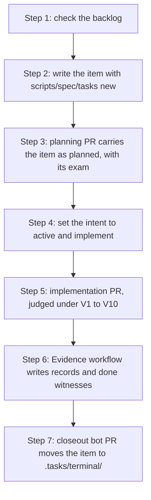

# How work flows

Project state is data that one program judges: `scripts/spec/check`. This page
gives a newcomer the timeline that rule produces, the reason for each step,
and the rule that enforces it. The pages it links to own the details. If you
already know why a planning PR lands before an implementation PR, skip to the
[decision tree](#which-path-am-i-on).

## The one idea behind all of it

A work item is a `task/v2` Zutai file under `.tasks/items/`. It names what
must become true and the `just` targets that prove it. The judge
`scripts/spec/check` runs on every PR from the base commit, so a PR cannot
change the judge that grades it. The rules V1 to V10 in
[the devloop v1.5 decision](../decisions/work-item-devloop.md#rules) refuse a
tree that contradicts the store.

| Convention | What breaks without it | Rule |
|---|---|---|
| Work item before implementation | Nothing binds evidence or a PR to a claim. "Done" becomes an opinion. | V2 |
| Planning PR merges before implementation PR | The branch under grading could rewrite its own exam. | V2, V3 |
| Backlog bugs first | A milestone built on a red suite records evidence nobody trusts. | V7 |
| Merge is not done | A landed diff proves nothing about a QEMU run, a hardware boot or a refusal. | V6 |
| Area promises are frozen | A shipped behavior could quietly lose its exam. | V10 |

## The timeline



### 1. Check the backlog

An open backlog bug is an item of kind `bug` with intent `#planned` or
`#active`. A failing promise counts as one. While either exists, no milestone,
and no item under one, may enter `#active`.

- **Why:** a milestone that starts on a red suite closes on evidence nobody
  can tell apart from the earlier failures.
- **Enforced by:** V7 in `scripts/spec/check`.
- **Look:** `just spec_tasks_status` lists every item's state.
  `just spec_status` lists every area promise, failing ones first.

### 2. Write the item

Every implementation path needs an item that owns it. Print a skeleton with a fresh
UUIDv7 and fill it in:

```sh
python3 scripts/spec/tasks new task <slug> --area <area> > .tasks/items/<slug>.zt
just spec_tasks_check
```

The kind is `task`, `bug` or `milestone`. The area names a file under
`specs/`. The item lists `owns` path globs, requirements, and acceptances.
Each acceptance is `h.observed "<just target>"` or `h.human "<id>" "<question>"`.

- **Why:** an item written as data can be judged complete. Prose can only be
  asserted.
- **Never:** invent or reuse a UUID. The UUID never changes. The slug is the
  file name.
- **Read:** [Carrying a work item](06-work-item-lifecycle.md) walks every
  field.

### 3. Planning PR first

Open a PR that carries the item with `intent = #planned` and its exam: the
recipe and checker that the acceptances name. Merge it before the
implementation PR.

- **Why:** the exam must be on `main` before the answer is graded. An
  implementation PR that touches the grader set of any bound target fails V3.
- **Enforced by:** V1 (one class per PR), V2, V3. A change to an existing
  grader also needs a V4 approval.
- **Scope:** one item may carry several implementation PRs inside its `owns`.

### 4. Set #active and implement

Change only `intent = #active` in the item. The judge classes an intent-only
item change as implementation, so it rides in the implementation PR.

Route the change through [`docs/task-to-file.md`](../task-to-file.md). Read
the named module root, not a grep across the tree. Two rules catch most
newcomers:

- **Generated outputs are not sources.** Change the `schema.zt`, system spec
  or generator source, and rerun the generator.
  [AGENTS.md](../../AGENTS.md#generated-code-rule) lists them.
- **Closures name their inputs. The checkout supplies the digests.** An edit
  to root or component code needs no closure regeneration. Rerun
  `python3 scripts/generate/generate-system-image-closures.py` only when a
  closure's input set changes. [Your first change](04-first-change.md) shows
  what a resolved build records.

Run the narrowest gate that exercises the change. `just spec_record <target>`
runs it and writes the record CI would write. Finish with `just fmt_check_all`
and `just lint_all` for Rust, `just docs_check` and `just typos` for
documentation, and `just spec_check --base origin/main` for the whole branch.

### 5. Implementation PR

Use the [change](../../.github/PULL_REQUEST_TEMPLATE/change.md) or
[system-change](../../.github/PULL_REQUEST_TEMPLATE/system-change.md)
template. Its `Verification` table wants exact commands, the observed result,
and an evidence class: *direct*, *inherited* or *inference*. Name the item by
its slug and UUID.

- **Enforced by:** the `Spec judge` workflow runs V1 to V10 on every push and
  after each review. Every implementation path must sit under the `owns` of an
  item that is on base and `#active` on head (V2).
- **Approvals:** a grader change, an area invariant change, an existing
  contract schema change, or a change to `scripts/spec/`, `HUMAN_OWNERS`,
  `AGENT_ACCOUNTS` or `specs/allowed_signers` needs one approval on the head.
  The approver is in `HUMAN_OWNERS` and is not the author (V4).
- **Never** write `Closes #123` or `Fixes #123`. GitHub does not own
  completion here ([decision](../decisions/no-github-issue-projection.md)).

### 6. Evidence workflow

After each push to `main`, the `Evidence` workflow runs every claimed target.
It writes each record to the `evidence` branch, keyed by the target's closure
digest and signed by `ci`. It then signs a done witness for each `#active`
item whose mandatory acceptances are all enforced. Nobody records evidence on
a PR branch.

- **Why:** a record keyed by closure digest stays valid until an input of that
  target changes. No re-record is needed for an unrelated change.
- **Human acceptances:** a person answers each `h.human` question with
  `scripts/spec/human`. An answer binds to the item's requirements digest, so
  rewording the question asks it again.
- **Look:** `just spec_tasks_status` shows which acceptances are still
  claimed, failing or advisory.

### 7. Closeout bot PR

The closeout bot opens one PR per witnessed or cancelled item. The PR moves the
file from `.tasks/items/` to `.tasks/terminal/` byte for byte. V6 accepts the
move only with a signed done witness or intent `#cancelled`. Nobody runs a
"complete" command.

## Which path am I on?

```text
Does the PR change only process paths: docs/, .agents/, .github/,
scripts/spec/, a top-level *.md file?
├─ yes → PROCESS: no item. A change to scripts/spec/ needs a V4 approval.
└─ no: every implementation path needs an #active item whose owns covers it (V2).
   ├─ Does an open item on main already own the paths?
   │  └─ yes → EXISTING: skip 2 and 3. Set #active if it is #planned, then 4 to 7.
   ├─ Is it a defect?
   │  └─ yes → BUG: `tasks new bug`, then 3 to 7. It blocks milestone
   │            work until it is closed, blocked, deferred or cancelled.
   └─ otherwise → FEATURE or REFACTOR: the full 1 to 7.
```

Two cases people misfile:

- *A checker that grades a bound target* is part of the exam. Change it in a
  planning PR, with a V4 approval.
- *A promise that must change* is frozen in its area file (V10). A new item
  with `supersedes` replaces it.

## Working with an agent

An agent follows the same timeline. [AGENTS.md](../../AGENTS.md) states the
rules for agents in compressed form. You do not need to read it to
contribute: this page and [CONTRIBUTING.md](../../CONTRIBUTING.md) are the
versions for people. After "add X", an agent does the following:

1. It runs `just spec_tasks_status` and checks for open bugs (1).
2. It looks for an open item whose `owns` covers the request. Otherwise it
   writes one and proposes a planning PR before code (2, 3).
3. It sets `#active`, routes through `docs/task-to-file.md`, edits the owning
   source, and runs the narrowest gate (4).
4. It fills the PR template and separates what it observed from what it
   inferred (5).

On GitHub an agent pushes with a person's account. That person is the author
and cannot give the V4 approval on that PR. Review an agent's work against the
list above, not against the diff alone. The judge catches a skipped planning
PR or a self-graded exam. It does not judge the PR's evidence classes, or
whether a `#human` question was asked of a person.

## Where the details live

| Question | Page |
|---|---|
| The rules that bind a PR, exactly | [CONTRIBUTING.md](../../CONTRIBUTING.md), [devloop v1.5 decision](../decisions/work-item-devloop.md) |
| Every field and command of a work item | [Carrying a work item](06-work-item-lifecycle.md) |
| Which file owns my change | [Task-to-file index](../task-to-file.md), [Recipes](11-recipes.md) |
| What a gate is and how to add one | [Add a gate](07-add-a-gate.md) |
| Why the commit, item and docs own different records | [Development record ownership](../decisions/development-record-ownership.md) |
| A term I do not recognise | [Glossary](../glossary.md) |
