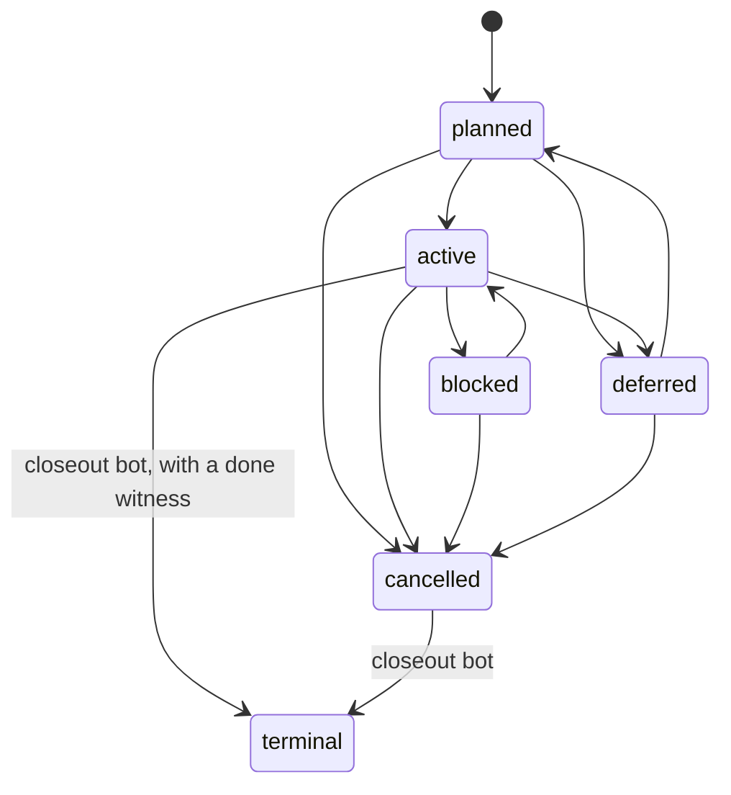

# Carrying a work item

A work item is a `task/v2` Zutai file. It is `.tasks/items/<slug>.zt` while
open and `.tasks/terminal/<slug>.zt` once closed. Its only hand-written state
is `intent`. The `evidence` branch decides whether it is done, and the
closeout bot moves it. `scripts/spec/check` judges every step. The rationale
is [the devloop v1.5 decision](../decisions/work-item-devloop.md).

## Who decides what

| Owner | Decides |
|---|---|
| The item file | Scope (`owns`), requirements, acceptances, `intent` |
| Area files `specs/<area>.zt` | The frozen promises: what a subsystem guarantees today |
| `scripts/spec/check`, from the base commit | Whether a PR is legal under V1 to V10 |
| The `Evidence` workflow on `main` | Records, keyed by closure digest, and done witnesses |
| The closeout bot | The PR that moves a witnessed or cancelled item to `.tasks/terminal/` |
| `HUMAN_OWNERS` | V4 approvals, and answers to `#human` acceptances |

Nobody runs a command that marks an item done.

## Anatomy of an item

Print a skeleton with a fresh UUIDv7, then fill it in:

```sh
python3 scripts/spec/tasks new <task|bug|milestone> <slug> --area <area> > .tasks/items/<slug>.zt
```

The skeleton imports the schema and helpers from copies beside it.
`.tasks/items/` and `.tasks/terminal/` carry byte-identical copies of
`contracts/task/v2/schema.zt` and `helpers.zt`, because Zutai refuses an
import above the entry file's directory. A filled item looks like this:

```text
item :: s.Item = (h.task "<uuid>" "<slug>" "<area>" "<title>" "<problem>")
  with {
    intent = #planned;
    owns = { "components/services/widget/**"; };
    requirements = {
      h.req "refuses-oversize" "<statement>" { "widget_check"; };
    };
    acceptance = {
      h.observed "widget_check";
    };
  };
```

| Field | Meaning |
|---|---|
| `id` | A UUIDv7. It never changes. |
| `slug` | The file name without `.zt`. |
| `kind` | `#task`, `#bug` or `#milestone`. An open `#bug` is a backlog bug. |
| `area` | The area file whose invariants bind the item. |
| `intent` | The only hand-written state. See [intents](#intents-and-legal-transitions). |
| `owns` | Path globs an implementation PR of this item may change (V2). |
| `requirements` | `h.req <id> <statement> { <acceptance ids> }`. |
| `acceptance` | `h.observed "<target>"`, `h.observedWhere "<target>" { <predicates> }`, or `h.human "<id>" "<question>"`. `h.advisory` makes one non-mandatory. |
| `parent`, `depends` | Item ids. A child of a milestone falls under V7. |
| `supersedes` | A terminal item, `<item id>/<requirement id>`, or an area requirement it replaces. |
| `nonGoals`, `invariants`, `decisions`, `knownLimits` | Each entry carries a provenance: `h.agentDefault`, `h.fromHuman`, `h.fromDecision` or `h.acceptedDefault`. |

An `h.observed` acceptance holds when the target's record at its current
closure digest passed and meets every predicate. An `h.human` acceptance holds
when a person in `specs/allowed_signers` signed yes.

`just spec_tasks_check` refuses a malformed item or area, a schema copy that
differs from `contracts/task/v2/`, and a broken link.

## Intents and legal transitions

`EDGES` in `scripts/spec/lib.py` lists the legal transitions. V5 refuses any
other. Done is not an intent: the closeout bot moves the file.



| Intent | Use |
|---|---|
| `#planned` | The item and its exam are on `main`. Its targets are never recorded. |
| `#active` | Work has started. The `Evidence` workflow claims its targets. |
| `#blocked` | Work started and stopped on something outside the repository. |
| `#deferred` | Postponed. A deferred item is planned again before it starts. |
| `#cancelled` | Not done. The closeout bot moves it without a witness. |

Entering `#deferred` or `#cancelled` needs a V4 approval.

## The pull requests of one feature

Every PR has one class, judged from its paths (V1).

| PR | Carries | Rules that bind it |
|---|---|---|
| Planning | The item with `intent = #planned`, and its exam: the recipe and checkers its acceptances name | V1. V4 if it changes an existing grader or area invariant. |
| Implementation | `intent = #active` and the product change, inside `owns` | V2: every implementation path is under `owns` of an item that is on base and `#active` on head. V3: no path in the grader set of a bound target. |
| Closeout | The item file moved to `.tasks/terminal/` byte for byte | V6: a signed done witness, or `#cancelled`. |
| Process | `docs/`, `.agents/`, `.github/`, `scripts/spec/`, top-level `*.md` | V4 for a change to `scripts/spec/`, `HUMAN_OWNERS`, `AGENT_ACCOUNTS` or `specs/allowed_signers`. |

The planning PR merges first. An implementation PR that changes only an item's
`intent` beside product paths is still one implementation PR. One item may
carry several implementation PRs. A planning PR may edit the exam of an open
item directly, with a V4 approval.

## Areas and frozen promises

An area file `specs/<area>.zt` lists what one subsystem promises today. Each
requirement is a promise with a UUIDv7 and its own acceptances. A requirement
marked planned has no bound exam yet and reports `advisory`.

V10 freezes area requirements. A PR that adds, changes or removes one is
refused. An item replaces a promise through its `supersedes` field. The
superseded requirement stays in the file and is no longer claimed. A terminal
item that nobody superseded is a promise too.

`specs/legacy.zt` indexes every work item of the earlier store: its id, last
state, kind, title, and `frozenAt` commit. The full text of each one is in Git
at that commit.

## Bound targets and the grader set

A **bound target** is a `just` target that one of these binds: an open item
that is not cancelled, a terminal item nobody superseded, or an area
requirement. Its **grader set** is the recipe chain and the checker files that
decide its result. `just spec_closure --explain` lists the composition of
every bound target's closure digest.

| Change | Rule |
|---|---|
| A file in the grader set of a bound target, in an implementation PR | V3 refuses. |
| The same file, in a planning PR | V4 approval. |
| A grader of a target bound by a promise | A new item, with V4 approval. |

## Evidence

The `Evidence` workflow runs after every push to `main`. It claims each target
that has no record at its current closure digest and that one of these binds:
an area requirement that is neither planned nor superseded, an `#active` item,
or a terminal item nobody superseded.

1. It runs each claimed target under `scripts/spec/record`, sharded by the
   wall times in `specs/targets.toml`.
2. It signs each record as `ci` and commits it to the `evidence` branch at
   `<target>/<closureDigest>.zt`.
3. It signs a done witness at `done/<item id>/<digest>.zt` for each `#active`
   item whose mandatory acceptances are all enforced.
4. It runs the closeout bot.

A record stays valid until an input of its target changes the closure digest.
`passed` comes from the exit status, never from the checker's own report.
A record from a dirty tree cannot be published.

Run the same steps locally:

| Command | Does |
|---|---|
| `just spec_record <target>` | Runs the target and writes `build/observations/<target>.zt`. |
| `just spec_closure` | Prints the closure digest of every bound target. |
| `just spec_status` | Prints each area requirement's state: enforced, failing, claimed, advisory or superseded. `--local` also reads `build/observations/`. |
| `just spec_tasks_status` | Prints each item's state from the `evidence` branch. |

A target under `operator` in `specs/targets.toml` needs hardware CI does not
have. An operator in `specs/allowed_signers` runs it and signs the record:

```sh
python3 scripts/spec/record <target> --signer <principal> --key <ssh key>
```

## Human acceptances

A person answers an `h.human` question in a signed record:

```sh
python3 scripts/spec/human item <item id> <acceptance id> yes --signer <principal> --key <ssh key> --note "<what they saw>"
python3 scripts/spec/human area <area> <requirement id> <acceptance id> yes --signer <principal>
```

The record binds to the item's requirements digest. Rewording a statement or
an acceptance asks the question again. The principal must be in
`specs/allowed_signers`. Record an answer only when the person gave it.
Automation never infers one. `scripts/spec/publish` carries the record to the
`evidence` branch.

## Closeout PRs

The closeout bot runs on `main` after the `Evidence` workflow. For each item
that is `#cancelled` or has a valid done witness at its current digest, it
creates the branch `closeout/<slug>`. That branch moves the item file to
`.tasks/terminal/` unchanged. The bot pushes the branch and asks the host to
open the PR and merge it once V6 passes.

The bot uses a GitHub App token, minted per run from the repository variable
`CLOSEOUT_APP_ID` and the secret `CLOSEOUT_APP_PRIVATE_KEY`. A PR opened with
the workflow's built-in token triggers no checks, so V6 would never run. With
no `CLOSEOUT_APP_ID`, the job skips closeout.

A terminal item is immutable. V6 refuses any later change to it and any
deletion.

## What the judge checks

`just spec_check` judges the store alone. `just spec_check --base origin/main`
judges your branch as CI does. CI runs the base commit's copy of the judge, so
a PR cannot change the judge, `HUMAN_OWNERS`, `AGENT_ACCOUNTS` or
`specs/allowed_signers` that judge it.

| Rule | Refuses |
|---|---|
| V1 class | A PR with more than one class, or a path the class table does not list. |
| V2 planning first | An implementation path under no `owns` of an item that is on base and `#active` on head. |
| V3 no self-grading | An implementation PR that touches the grader set of any bound target. |
| V4 grader approval | A grader change, area invariant change, existing contract schema change, or judge change without one approval on the head from `HUMAN_OWNERS` by someone other than the author. |
| V5 legal intent | An `intent` change outside `EDGES`. Entering `#deferred` or `#cancelled` without a V4 approval. |
| V6 closeout | A move to `terminal/` without a signed done witness, unless the item is `#cancelled`. Any later change to a terminal item. |
| V7 backlog first | A milestone, or an item under one, entering `#active` while a backlog bug is `#planned` or `#active`, or while a promise fails. |
| V8 R4 floor | A lowered `negativeControlsRefused` predicate without an approved R4 known limit. Milestone M5: the judge does not enforce it yet. |
| V9 provenance | A `#human` quote shorter than 8 characters, a blanket answer, or a PR number as source. Warning only. |
| V10 frozen promises | An added, changed or removed area requirement. |

The `Spec judge` workflow runs on every PR push and after each review. A
repository ruleset requires it from `main`. `just spec_e2e` is the judge's own
exam: it walks a fixture repository through every stage.

## No GitHub projection

Work items are not projected into GitHub Issues or milestones
([decision](../decisions/no-github-issue-projection.md)). `.tasks/` is the only
work-item state. Never use a GitHub auto-close keyword to complete work.
[`CONTRIBUTING.md`](../../CONTRIBUTING.md) owns the full PR workflow.

## Next

[Add a gate](07-add-a-gate.md) — an `h.observed` acceptance binds a gate. This
page shows how one is built.
