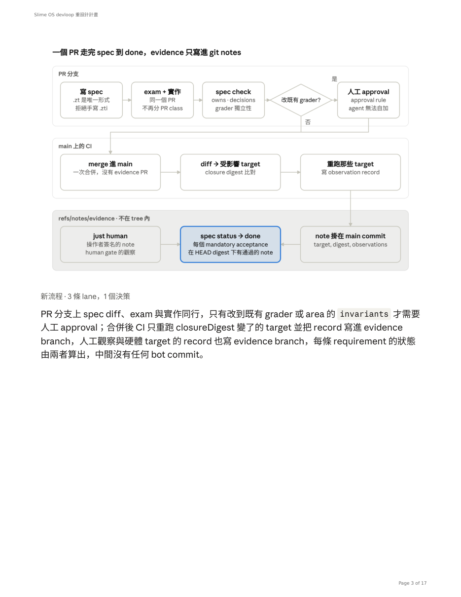

# Slime OS devloop 重設計計畫

Nov 5, 2026 · @Brian Duan

> 由 `~/Downloads/Slime OS devloop 重設計計畫.pdf`（17 頁）抽出，2026-11-07。表格依 PDF 版面重建；第 3 頁流程圖見 [`diagram-p03.png`](diagram-p03.png)。
> 這是 `slime_os-v2/proposal/devloop-redesign.md`（同日期）之後的修訂版：spec 從「一檔一 work item」改為「一個 area 一檔、requirement 為工作單位」，沒有 `admit`，沒有 `done` 狀態，新增 D8、D9、D11。

## 目標與不能丟的 invariant

目標：一個功能從 spec diff 到 enforced 只走一個 PR，evidence 不再進 tree，Zutai 可以獨立 bump，CI 與 host 無關。量化上，`repo/tasks` 類 commit 從最近 200 個 commit 中的 126 個降到 0，grader 修復不再需要獨立 item。

重設計不從工具開始，從現有流程真正保護的五條 invariant 開始。任何階段的設計決定都要能回答「這條保住了沒」。

| # | Invariant | 今天靠什麼實現 | 新系統靠什麼實現 |
| --- | --- | --- | --- |
| 1 | 「做完了」由機器判定，agent 無法自稱完成 | devloop gate + `complete` 檢查 | CI 在 main 上跑 gate，每條 requirement 的 enforced 由 evidence branch 算出；沒有 `done` 這個狀態 |
| 2 | 給 code 打分的 grader 不能被那份 code 偷偷改掉 | 四種 PR class + `check-pr-scope.py` | `check-grader-independence`：改到任何 non-done spec 所綁閉包的既有檔案就要人工 approval |
| 3 | Evidence 綁在精確輸入閉包上，可重現 | `identity.code/inputs/policy/helper` digest + 24h TTL | closure digest 單獨決定失效，無 TTL |
| 4 | 人決定 scope、invariant、known limit | HUMAN.md、`Decision: … Because …` | spec 內的 `decisions` 與 `openQuestions` 欄位 |
| 5 | 工作追蹤離線、在 repo 內、UUID 識別 | `.tasks/` + MyQue | requirement 層的 UUIDv7 不變；backlog = spec status 裡未 enforced 的 requirement + `roadmap/` |

被丟掉的全是手段：PR class、evidence-only PR、closeout bot、retirement、TTL、311 條 `codePaths`、`dev-spec/v1` 的 predicate 編碼、`.devloop/inputs/*.json`、terminal records。

## 目標架構：Spec、Exam、Git

新系統只有三樣東西：spec 是系統現在承諾什麼的 living document，一個 plane 或子系統一檔；exam 是普通測試；evidence branch 是 evidence。沒有 work item 這個第四樣：一個功能是一個 PR 對 spec 的 diff（新增或改掉幾條 requirement，加 exam，加實作），backlog 是 spec 裡還沒 enforced 的 requirement 加 `roadmap/`。reviewer 讀的是「系統的承諾改了什麼」，不是一份孤立的 ticket；decision 和 openQuestion 跟著主題留下來，不跟著 ticket 關掉。

### 新流程 · 3 條 lane，1 個決策



> 圖中三條 lane：**PR 分支**（寫 spec → exam + 實作 → spec check → 改既有 grader? → 是：人工 approval）、**main 上的 CI**（merge 進 main → diff → 受影響 target（closure digest 比對）→ 重跑那些 target，寫 observation record）、**evidence 存放**（`just human` 操作者簽名 → `spec status → done` ← record 掛在 main commit）。
> 注意：圖的標題與第三條 lane 仍寫「git notes / `refs/notes/evidence`」，內文已改為 evidence branch；以內文為準。

PR 分支上 spec diff、exam 與實作同行，只有改到既有 grader 或 area 的 `invariants` 才需要人工 approval；合併後 CI 只重跑 closureDigest 變了的 target 並把 record 寫進 evidence branch，人工觀察與硬體 target 的 record 也寫 evidence branch，每條 requirement 的狀態由兩者算出，中間沒有任何 bot commit。

### 目錄配置

```
specs/
  helpers.zt            # requirement / observed / human / decision / count / atLeast / passed / all
  schema.zt             # Area 與 Requirement 的 Zutai 型別
  <area>.zt             # 一個 plane 或子系統一檔：這個 area 現在承諾的 requirements
  legacy.zt             # 舊 item 的 UUID → { state, title, frozenAt, requirements: [新 id] } 索引
  allowed_signers       # 可簽 record 的 ssh 公鑰，含 CI 的
roadmap/                # 還沒寫進 spec 的方向，不變
scripts/spec/           # 新 CLI：check / status / human / attest / render / migrate
evidence (branch)       # <target>/<closureDigest>.zt，簽名 record，永不進 main 的 tree
```

### Spec 格式

一個 area 檔是一個 `Area` 值：`{ id; title; owns; invariants; decisions; openQuestions; requirements }`。工作的單位是 requirement，不是檔：改一個功能就是在對應 area 檔裡新增、改寫或刪除幾條 requirement。`.zt` 是唯一能進 repo 的形式；`.zti` 與 `requirementsDigest` 由 `just spec_gen --check` 計算，不 commit。先例是 `contracts/system-image-closure/v3`（`closure_derivation_check` 要求沒有任何 resolved closure 被 commit），照那條做。

| 欄位 | 層級 | 必填 | 內容 |
| --- | --- | --- | --- |
| `id`, `title`, `owns` | area | 是 | `owns` 是這個 area 實作的路徑 glob，取代整份 `codePaths` |
| `invariants` | area | 是 | 3–5 句，人寫或人核；改它要人工 approval，與 grader 同等 |
| `decisions` | area | 否 | `h.decision <id> <question> <options> <chosen> <byHuman>`，跟著主題累積，不跟 ticket 關掉 |
| `openQuestions` | area | 否 | 沒人決定的事，reviewer 第一個看的地方 |
| `requirements[].id` | requirement | 是 | UUIDv7，進 main 後不再改；取代 item 的 id |
| `requirements[].statement`, `rationale` | requirement | 是 | 一句承諾、一段為什麼 |
| `requirements[].acceptance` | requirement | 是，至少一條 automated | `h.observed <id> <justTarget> <predicate> <mandatory>` 或 `h.human <id> <observation>`；predicate 是 `h.count "casesObserved" 12`、`h.atLeast … 3`、`h.passed`、`h.all {…}` |
| `requirements[].planned` | requirement | 否 | `true` = 已承諾要做但還沒綁 target；舊的 open / deferred / blocked 全部是這個，差別寫在 note |
| `requirements[].supersedes` | requirement | 否 | 被它取代的 requirement id（新或 legacy）；被取代與 cancelled 的 requirement 從檔中刪除，歷史在 git log |

`requirementsDigest` 對每條 requirement 各算一個，只算 `statement` + `acceptance` 的 canonical value，不算 `rationale`、`planned`、area 層的 `decisions` 與 `openQuestions`，也不算 helper 或 compiler identity。改一句 decision 措辭、改同檔內另一條 requirement、或 bump Zutai，都不 stale 這條的 evidence。

### Exam

每個 `just` target 都可以寫一份 Zutai 格式的 observation record 到 `target/observations/<target>.zt`，`passed` 只是其中一個欄位。`just-target` 與 `just-observations` 的區別消失。`verification-checkers` skill 中「每個正向斷言要有 negative control」不變。

closureDigest 分三段，今天沒有一個 resolver 涵蓋全部：

1. `devloop-approval.py` 的 `verification_closure` —— recipe 依賴閉包裡的 script token 加 `scripts/lib` 的靜態 import，這段現成；
2. target 啟動的 system image 的 closure derivation id（`contracts/system-image-closure/v3`），今天靠 `--image` 手填，要改成 recipe 宣告或 checker 自報；
3. product 面 —— 今天是 312 條 `codePaths` 的一個全域 digest，刪掉後由 D8 決定。

### Status 與反向綁定

`spec status` 對每條 acceptance 報四態，不是一個 done bool：**enforced**（HEAD 的 closure digest 下有通過的 record）、**failing**（有 record 且失敗）、**claimed**（綁了 target 但 HEAD digest 下沒有 record）、**advisory**（human gate 尚未觀測，或 `mandatory = false` 且無 record）。綁了 target 且 `planned` 的 requirement 報 **planned**。沒有 done：一個 area 的進度是 enforced 的 requirement 數，`spec status --unenforced` 列出 claimed / advisory / failing / planned 的 requirement，那就是 backlog。

綁定方向保留 spec → target 名，`spec check` 驗 target 存在於 `just --list`，改名不能無聲孤兒。checker 檔內可以加 `# spec: <uuid>/<acceptance>` 反向標記，`spec check` 驗它指向存在的 acceptance；這讓 vsdtdd 的 reader 不用解析 `just` recipe 就能畫 verifies 邊。格式在 Phase 1 定下後要跟 vsdtdd 的作者對一次：他現有的 `slimeos-packets`、`gates-just`、`results-slimeci` reader 讀的是今天的 `.tasks/` 與 `.devloop/`，切換後要換成讀 `specs/*.zt` 與 evidence branch。

### Evidence

evidence 存在一條 orphan branch `evidence`，路徑 `<target>/<closureDigest>.zt`，內容 `{ target, closureDigest, observations, observedAt, runner, toolchain }`，永不進 main 的 tree。選 branch 而不是 `refs/notes/evidence`，三個理由：GitHub 與 GitLab 的 branch protection 只涵蓋 branch 與 tag，notes 誰有 push 權都能改寫，invariant 2 的 evidence 端等於沒有保護；done 的查詢是「檔案存在且 passed」，O(1)，不必沿 notes 歷史回溯找相同 digest；並發 push 走普通的 fast-forward 規則。

CI 在 main 每次 push 後重算每個 target 的 closureDigest，與 evidence branch 已有的 record 比對，缺的才重跑（不需要 diff→target 的對照表，也不會漏掉 resolver 沒看到的路徑）並寫入；切換後第一次執行全部重跑。done 的定義：spec 的每個 mandatory acceptance 在 main HEAD 的 closure digest 下都有通過的 record。

Human gate 用 `just human <spec> <acceptance> <value>` 寫一條 record，內容以 `ssh-keygen -Y sign` 簽名，`specs/allowed_signers` 列出可簽的人，`spec status` 用 `-Y verify` 驗。不靠 commit 簽名：`git notes` 的 commit 不吃 `commit.gpgsign`，而 CI token 推的 commit 本來就不是人簽的。

### Grader independence

一個 PR 可以同時帶 spec diff、exam、實作。唯一硬檢查 `check-grader-independence`：以 base 上所有 requirement 為準，不分 enforced 與否，PR 若修改了任何一條 acceptance 所綁 target 閉包中、在 base 上已存在的檔案，或改了任何 area 的 `invariants`，CI 要求一個人工 approval，否則拒絕；新增的 checker 檔案自由進。規則不看 PR 裡有沒有 spec diff，也不看 `owns`：前者封掉「先一個 PR 改 grader、再一個 PR 實作」的拆分，後者封掉用寫窄的 `owns` 躲檢查。`owns` 仍然必填，用途是 `spec check` 的覆蓋檢查：PR 碰到的每個 product 檔都要在某個 area 的 `owns` 下；碰不到任何 area 的 chore（rename、fmt、純重構）走同一個人工 approval 出口，不另設 PR class。

範圍是全部 requirement，因為 spec 沒有 done 這個狀態：一條已 enforced 的 requirement 和一條 claimed 的受同樣保護，「同一個 PR 削弱 grader 並回歸實作」在兩者上都會觸發 approval。代價是共用 lib（`sel4_plane.py`、`harness.py`）幾乎每改必觸，見風險一節。

### Zutai pin

Zutai 視同 rustc：pin 在 `sel4/pins.toml`，evidence 記成 metadata（與 `target: x86_64-linux` 同層），不進 closure digest。只有執行期呼叫 `zutai-cli` 的 target（`spec_gen --check`、`contracts_check`）才把它算進閉包。`flake.nix` 的 `zutai` input 拿掉，`nix/zutai.nix { src = ./deps/zutai }`，submodule 是唯一真相，`check-sel4-pins` 多驗一列。

閉包 digest 要包含 `rust-toolchain.toml` 與 `sel4/pins.toml`，否則 rustc 或 seL4 bump 之後舊 evidence 照算通過；record 裡的 `toolchain` 欄位是 metadata，不是替代。選 submodule 之後 flake eval 要帶 `?submodules=1`，CI checkout 改 recursive，這兩件事在 Phase 2 就會碰到，不是 Phase 5。

## 刪除清單

刪掉的東西比新寫的多。每一列都在某個 phase 消失，phase 欄對應下一節。

| 類別 | 刪除 | 取代 | Phase |
| --- | --- | --- | --- |
| 目錄 | `.devloop/`（policy、inputs、examples） | `specs/helpers.zt`、`specs/schema.zt`，acceptance 直接寫 target 名 | 3 |
| 目錄 | `.tasks/items/`、`.tasks/terminal/` | `specs/<area>.zt`；spec-driven item 的 requirements 歸戶進 area 檔，全文進 history archive，repo 留 `specs/legacy.zt` 索引 | 3 |
| Workflow | `myque-closeout.yml`、`myque-retire.yml` | `evidence.yml`：main push 後重跑受影響 target，寫 evidence branch | 3 |
| Scripts | `check-pr-scope.py`、`scripts/lib/pr_scope.py` | `check-grader-independence.py` | 3 |
| Scripts | `devloop-approval.py`、`devloop-gate.py`、`scripts/lib/devloop.py` | `scripts/spec/` CLI | 3 |
| Scripts | `check-work-items.py` 中 codePaths 覆蓋、evidence 驗證、terminal record 的部分 | `spec check` | 3 |
| Scripts | `work_item_closeout_publish*.py`、`work_item_retirement_publish*.py` | 無；evidence 不再是 PR | 3 |
| Scripts | `scripts/lib/devloop_observations.py` | observation record 的 Zutai schema + 一個寫入 helper | 1 |
| Schema | `dev-spec/v1`、`fenced-zti/v1`、`devloop-consumer/v1` | `specs/schema.zt`、observation schema | 1 |
| Flake | `myque`、`devloop`、`myque-gh` 三個 input | 無；留 `zutai`，改由 submodule 提供 | 3 |
| Just | `tasks_check` 中的 devloop 驗證、`devloop` recipe、`tasks_list/next/graph` | `spec_check`、`spec_gen`、`spec_status` | 3 |
| Docs | work-item-lifecycle skill、CONTRIBUTING.md PR class 一節、`docs/getting-started/06-work-item-lifecycle.md`、`docs/decisions/spec-driven-work-item-bodies.md` | 重寫，一半篇幅 | 4 |
| Flake / CI | `nix/devloop.nix`、`.#projection` devShell、`.github/actions/slime-zutai-store-save`、`ci.yml` 的 `work_items` job 與 `automation/myque-retire/` 分支條件 | `evidence.yml`、`spec_check` job | 3 |
| Just | `closeout_checkout_check`、`issue_projection_retired_check`、`devloop_diagnostics_check`、`devloop_observation_capacity_check` 與兩個 controls | 無 | 3 |
| Docs | `docs/decisions/mandatory-spec-driven-work-items.md`、`no-github-issue-projection.md`；另有 43 份 docs 提到 devloop / myque / work item | 併進 Phase 4 清單；`docs_check` 的 anchor 會揪出失效連結 | 4 |
| 目錄 | `.tasks/admissions/`（119 個 request digest）；tree 內的 `evidence/`（duo、framework-cpu-boot 的硬體 transcript） | 前者無；後者依 D9 | 3 |
| Scripts | `devloop_cli.py`、`devloop_diagnostics*.py`、`devloop_capacity_audit.py`、`observation_capacity*.py`、`generate-devloop-diagnostics-bindings.py`、`contracts/devloop-diagnostics/`、`work_items.py`、`work_item_retirement*.py` | 無；diagnostics 併入 observation record 的 `runner` 欄位，reader 進 `scripts/spec/` | 3 |

保留不動：`AGENTS.md` 的 code review 規則、`pr-review` 與 `spec-review` skill 的大部分、`verification-checkers` skill、HUMAN.md、`writing-style` skill、`roadmap/`、`docs/history.md` 的 archive 規則。

## 分階段計畫

六個 phase 依序進行，每個 phase 結束時 repo 可用、CI 綠、既有 spec-driven item 仍能驗證。Phase 0–4 在 GitHub 上完成，Phase 5 才搬 GitLab；搬遷前先把簿記那層砍掉，否則會把它原封不動搬過去再重寫一次 closeout bot。

1. **Phase 0 — 凍結與量測（1 天）**
   - 停止 admit 新的 dev-spec/v1 item；進行中的 5 個 active item 照舊流程收尾或直接改用新格式。
   - 記下基線：最近 200 commit 中 repo/tasks 126 個、feature 平均 4 PR、evidence re-record 5 次。Phase 4 結束時對照。
   - 在一台自架 runner 上量兩個數字：(1) `just test` 在 x86 TCG 下的 wall time，決定 Phase 5 的 arm64 runner 方案；(2) 今天所有 non-done spec 綁定的 target 全部跑一次的 wall time（約 50 份 `.devloop/inputs`，多數是 arm64 QEMU plane，今天 CI 不跑它們，是 agent 在自己機器上跑）。`evidence.yml` 把 gate 執行從 agent 的機器搬到 CI，所以第二個數字擋的是 Phase 2 與 D8，不是 Phase 5。
   - 離場條件：main 上沒有半完成的 planning PR。
2. **Phase 1 — Observation record 與 helpers（2–3 天，純新增，不刪）**
   - 寫 `contracts/observation/v1/schema.zt`：`{ target; closureDigest; observations; observedAt; runner; toolchain }`。
   - 寫 `specs/schema.zt`（`Area`、`Requirement`）與 `specs/helpers.zt`；把 stale-handle 那個 item 歸戶成 `specs/sel4-lifecycle.zt` 裡的一條 requirement，驗證算出的值等價於它現有的 `.zti`。
   - 改 `scripts/lib/devloop_observations.py` 同時寫舊格式與新 record，兩邊並存。
   - 跟 vsdtdd 的作者對 `specs/*.zt`、evidence branch 與 `# spec:` 標記的格式。
   - `specs/`、`scripts/spec/`、`contracts/observation/` 加進 `check-work-items.py` 的 `CODE_IDENTITY_EXEMPT`，不是 `codePaths`：`tasks_check` 會拒絕沒人覆蓋的 tracked file，而進 `codePaths` 等於每次改 spec 都 stale 全部舊 evidence。
   - 離場條件：`just spec_gen` 能把一個 area 檔算成每條 requirement 的 `.zti`，其中歸戶自舊 item 的那條通過現有 devloop validate。
3. **Phase 2 — 新 CLI 與 evidence pipeline（1.5 週，純新增，舊 loop 照跑）**
   - `scripts/spec/`：check（schema、owns 覆蓋、target 存在於 `just --list`、supersedes 指得到、invariants 改動標記）、status、human、attest（D9）、render、migrate。沒有 admit：進 spec 的就是一個 PR。
   - `check-grader-independence.py` 與 `check-pr-scope.py` 在 CI 並行跑，兩個都 required，先看新規則在真實 PR 上觸發多少。
   - `evidence.yml`：main push 後重算每個 target 的 closureDigest，與 evidence branch 比對，缺的重跑，寫 evidence branch；首次執行全部重跑；用 `scripts/lib/ci_env.py` 讀 host 變數。
   - `spec status` 從 evidence branch 算四態；`just human` 寫 `ssh-keygen -Y sign` 簽名的 record。
   - Zutai pin 併入 `sel4/pins.toml`，`check-sel4-pins` 多驗 submodule 一致；flake eval 帶 `?submodules=1`，CI checkout 改 recursive。
   - 不刪任何東西：`.tasks/`、`.devloop/`、closeout bot 照常運作。
   - 離場條件：一個真實功能走完 spec diff + exam + 實作同一 PR 合進 main，`spec status` 在 main 上自動把它的 requirement 算成 enforced，過程中沒有任何 bot commit。
4. **Phase 3 — 切換與刪除（3–4 天）**
   - `spec migrate` 把 104 個 spec-driven item 歸戶進 area 檔（一個 PR，人核 area 屬歸與 `planned` 標記）；`.tasks/` 全文進 history archive，repo 留 `specs/legacy.zt` 索引；`.devloop/` 刪除；flake 拿掉 `myque`、`devloop`、`myque-gh`。
   - 刪 `check-pr-scope.py`、`devloop-*.py`、`myque-closeout.yml`、`myque-retire.yml`、兩組 publish script；`tasks_*` recipe 換成 `spec_*`。
   - evidence branch 設 branch protection：push 限 CI token 與 `allowed_signers` 內的人，禁止 force push 與刪除；branch 上每條 record（CI 寫的也是）都用 `ssh-keygen -Y sign` 簽，CI 的 key 放 secret 並列在 `allowed_signers`，`spec status` 只採信驗得過的 record —— 否則 `just human` 與硬體 target 的 record 根本推不上去；`.git/config` 與 CI 設定加上 fetch。
   - 離場條件：CI 綠；刪除清單中 Phase 3 的每一列都不在 tree 上；第一次全跑後 `spec status --unenforced` 的清單被人看過一遍（那是真實的 backlog）；第二個真實功能從 spec diff 到 enforced 走完。
5. **Phase 4 — 文件與 skill 重寫（2–3 天）**
   - work-item-lifecycle skill 改名 spec-lifecycle、縮到一頁，硬規矩只有一條：改行為就改 spec，沒有 spec diff 的行為變更不合併；spec-review skill 改成「先讀 area 的 openQuestions，再讀 spec diff，最後讀 code diff」。
   - CONTRIBUTING.md 的 PR class 一節換成 grader independence 一節；AGENTS.md 的 Commands 與 Work items 兩節改寫。
   - `docs/decisions/` 新增一篇記錄這次重設計與被放棄的方案（git notes、`specs/legacy/`、原版 grader 規則）。
   - 離場條件：`just docs_check` 綠；用 Phase 0 的基線跑一次對照，repo/tasks 類 commit 為 0。
6. **Phase 5 — GitLab（1 週，見下節）**

## 舊 work item 的歸戶

不重新編碼，但會歸戶。`.tasks/` 的 167 個 item（2026-11-06 計，Phase 0 凍結時重數）裡 104 個是 spec-driven，body 已經是 dev-spec/v1 的 requirements + acceptance 結構，`spec migrate` 把它們機械地歸戶進對應的 area 檔：item 的 UUID 變成 legacy id，每條 requirement 拿新的 UUIDv7，`supersedes` 指回 legacy id，acceptance 照搬。剩下 63 個 prose item 不歸戶。所有 item 與 `.tasks/terminal/` 的全文照 `docs/history.md` 的規則進 history archive；repo 內只留 `specs/legacy.zt`，一張 UUID → { state, title, frozenAt, requirements } 的索引，167 行。第一次 `evidence.yml` 全跑會把 66 個 done item 裡 grader 已經 rot 的標成 failing 或 claimed —— 這是 item 模式下永遠不會做的體檢，也是選 living spec 最直接的回報。

| 狀態 | 數量 | 處置 |
| --- | --- | --- |
| `done` | 66 | requirements 歸戶進 area 檔，acceptance 照搬；第一次全跑後 failing / claimed 的就是真實 backlog |
| `cancelled` | 18 | 不歸戶，只留索引 |
| `deferred` | 45 | 歸戶，標 `planned: true`，note 寫為什麼擱置 |
| `blocked` | 5 | 同 `deferred`，note 寫 block 在哪 |
| `open` | 28 | 逐一判斷：要做的歸戶成 `planned`，不做的只留索引 |
| `active` | 5 | Phase 0 決定（D3）：立即歸戶，它們是第一批 enforced 的試驗品 |

`docs/history.md` 已經規定 archive 的東西不參與現行驗證。舊 `depends` 與 `parent` 邊不搬：歸戶後的 requirement 沒有這兩個欄位，依賴關係由 target 是否存在與 `supersedes` 表達；外部引用 legacy id 時由 `legacy.zt` 解成新的 requirement id。兩個被放棄的方案：搬進 `specs/legacy/` 代表新 CLI 與每個未來的 reader 都要永遠認兩種格式；一個 feature 一個 `specs/<slug>.zt` 的 item 模式則會讓 done 的 requirement 凍結在各自的檔裡，「系統現在承諾什麼」要回放 N 個檔才知道。item 模式是 living spec 的特例，退回去幾乎免費，反方向要重新歸戶，所以選更一般的那個。

## GitLab 搬遷工作項

前提是 Phase 3 做完：closeout、retirement 與 evidence PR 這三個與 GitHub API 最糾纏的東西已經不存在，剩下的耦合只有 CI 語法、幾個環境變數與外部依賴的位置。

| # | 工作項 | 現況 | 動作 |
| --- | --- | --- | --- |
| 1 | `.gitlab-ci.yml` | `ci.yml` 559 行、兩個 composite action | job 改 `extends:` / `!reference`；`GITHUB_OUTPUT` → `artifacts: reports: dotenv`；`concurrency` → `resource_group` + `interruptible` |
| 2 | Runner image | `dtolnay/rust-toolchain`、`Swatinem/rust-cache`、`setup-just`、`nix-quick-install-action` | 自建含 nightly-2026-05-26、just、nix 的 image；nix store 在 self-hosted runner 上直接持久化 |
| 3 | arm64 runner | GitHub arm64 hosted | 自備；或 x86 TCG 跑 AArch64 plane，`ci-wall-time` 數字重量 |
| 4 | `scripts/lib/ci_env.py` | Phase 3 新增 | 補 `CI_MERGE_REQUEST_DIFF_BASE_SHA`、`CI_COMMIT_SHA`、`CI_COMMIT_BEFORE_SHA`、`CI_PIPELINE_SOURCE`、`CI_PROJECT_PATH` 的對應 |
| 5 | `origin/main` 可用 | `check-grader-independence` 與 closure 比對讀 `origin/main` | `GIT_DEPTH: 0`、`GIT_SUBMODULE_STRATEGY: recursive`、job 內 `git fetch origin main` |
| 6 | Evidence branch 推送 | `secrets.GITHUB_TOKEN` | project access token，權限只及 `evidence branch`；protected branch 規則 |
| 7 | Submodule | 5 個指向 `github.com/iceice666/*` | 全部 pull-mirror 進同一 group，`.gitmodules` 改相對路徑；`sel4/pins.toml` 的 `repository` 與 `check-sel4-pins.py` 的 URL normalizer 同步改 |
| 8 | Flake inputs | `nixpkgs`、`rust-overlay` 為 `github:`；`nix/kani.nix` 從 GitHub release 下載 | runner 開 github.com 出網，或自架 binary cache 與 flake registry |
| 9 | SDK release repo | `publish-sdk.yml` 用 deploy key 推 `slime_os-component_sdk`，7 個 `check-component-sdk-*.py` 寫死 URL | 決定 SDK repo 去留；URL 集中到一個常數 |
| 10 | Review bot | `AGENTS.md`、`pr-review` skill 寫死 Codex P2 | 決定替代 reviewer；文字改泛稱 |
| 11 | MR template | `.github/PULL_REQUEST_TEMPLATE/*.md` | `.gitlab/merge_request_templates/*.md` |
| 12 | 歷史連結 | commit 尾碼 `(#946)`、`docs/history.md`、roadmap 中的 PR 連結 | 舊連結保留指向 GitHub archive，或在 GitLab 上留 redirect 說明 |
| 13 | `vars.MYQUE_CLOSEOUT_ENABLED` | GitHub repo variable | 隨 Phase 3 消失，無動作 |

## 要人決定的事與風險

照 HUMAN.md 的格式，每題給選項、成本與建議；回覆 `Decision: <option>. Because <one sentence>.` 就能開工。沒決定的題目在對應 phase 前會擋住進度。

| # | 問題 | 選項與成本 | 建議 | 擋住 |
| --- | --- | --- | --- | --- |
| D1 | Zutai pin 的唯一真相 | (a) submodule，flake 用 `src = ./deps/zutai`，eval 要帶 `?submodules=1`；(b) flake input，submodule 只為 skill symlink，兩處要同步 | (a)：GitLab 搬遷後不用 token，離線可建 | Phase 2 |
| D2 | Human gate 簽名 | (a) `ssh-keygen -Y sign` 簽 record 內容，`allowed_signers` 進 repo，key 隨人管；(b) 不簽，record 的 committer 身分即信任，弱 | (a) | Phase 3 |
| D3 | 既有 `active` 5 個 item | (a) 照舊流程收尾；(b) 立即改寫新格式 | (b)，因為它們是 Phase 2 離場條件的現成試驗品；而且 Phase 1–2 每個碰 `scripts/` 的 PR 都會改 `identity.code`，留在舊流程的 item 會不斷 re-record | Phase 0 |
| D4 | spec 沒有 done，進度怎麼看 | (a) 純計算，`spec status` 報 enforced / 全部，`git log` 看不到；(b) bot 每週 commit 一份 `specs/STATUS.md` | (a)；(b) 可以之後加 | Phase 3 |
| D5 | grader 修改需要的 approval 形式 | (a) 一個 label；(b) GitHub / GitLab 的 approval rule；(c) 由 `.zt` 內 `decisions` 的一條 `byHuman` 項目代表 | (b)，host 原生、不可被 agent 自己加 | Phase 2 |
| D6 | SDK release repo | (a) 留在 GitHub；(b) 一起搬 | 看 SDK 消費者在哪 | Phase 5 |
| D7 | 替代 Codex 的 reviewer | (a) GitLab 上跑 agent review；(b) 無 bot，人審 | 未定 | Phase 5 |
| D8 | product 面怎麼進 closureDigest | (a) 整個 product tree 一個 digest，改 product 就重跑全部 target，CI 成本看 Phase 0 的量測；(b) 每個 recipe / checker 自己宣告 product inputs，等於按 target 拆開的 `codePaths`；(c) 用綁該 target 的 spec 的 `owns`，agent 可寫窄，回歸後 done 照留 | (a) 起步，數字出來再決定要不要 (b)；(c) 不要 | Phase 1 |
| D9 | 硬體與人工執行的 target（duo、rpi5、Framework）的 record 怎麼來 | (a) 操作者本機跑，`just attest <target>` 寫帶 closureDigest 的 ssh 簽名 record 推 evidence branch（要 D2 給人 push 權）；(b) 留在 tree 的 `evidence/`，承認 evidence 有兩個家 | (a) | Phase 2 |
| D11 | area 檔的切分粒度 | (a) 一個 plane 一檔，跟 `just/planes-*.just` 的分組走，約 40 檔；(b) 一個 crate / 子系統一檔，檔少但大，多 PR 同改一檔會衝 | (a)；歸戶時 area 名就是 item 的 gate target 所屬的 plane | Phase 1 |

> PDF 中沒有 D10。

風險：

- evidence branch 的 append-only 靠 branch protection，不是靠慣例：push 限 CI token 與 `allowed_signers` 內的人，禁止 force push 與刪除，信任落在每條 record 的簽名而不是 push 權限，Phase 3 一設好就不再是選項。兩個 main push 同時寫會 non-fast-forward，`evidence.yml` 用 concurrency group 序列化，失敗 retry 一次。
- living spec 的兩個固有成本：多個 PR 同改一個 area 檔會衝，靠 requirement 有穩定 id、只追加不重排，衝突都是可解的文字衝突；行為改了、spec 沒改沒有 checker 能抓，`owns` 覆蓋只能逼 PR 碰到 spec 檔，不能逼它改對。防線是 spec-lifecycle skill 的那一條規矩和 review 順序；好處是 rot 會以 failing 浮出來，item 模式下它藏在關掉的 ticket 後面。
- 一個 PR 同時改 spec 與 code 時，reviewer 若先讀 code 會失去 spec diff 的脈絡。spec-review skill 的閱讀順序是唯一防線，Phase 4 要先於第二個真實功能進來。
- grader independence 會在共用 lib 上頻繁觸發（`sel4_plane.py` 幾乎在每個閉包裡）。這是設計，不是 bug：HUMAN.md 已把「scripts/ 的 PR 比 product 多」列為停下來看的信號，吵的地方正是該有人看的地方。Phase 2 並行期間量觸發率，太高就把共用 lib 的純重構列為例外，由人決定。
- `owns` glob 寫太寬讓覆蓋檢查形同虛設，寫太窄會被 `spec check` 擋；Phase 2 用前三個真實 spec 校準，之後寫進 skill 當慣例。
- `.zti` 序列化格式若在 Zutai 升級時改變，requirementsDigest 全部重算；digest 要算 canonical JSON 而不是 `.zti` 文字，Phase 1 就定下。
- Phase 5 的 1 週不含 arm64 runner 與 x86 TCG 的 wall time；repo 有五十幾個 `check-sel4-*-plane.py`，TCG 慢 10–20 倍。Phase 0 量到的數字決定要不要自備 arm64 runner；數字不出來不開始 Phase 5。

## 工作量與順序

總計約 4.5 週，其中 3 週在 GitHub 上完成重設計，1 週搬 GitLab，0.5 週緩衝。大部分工作可以交給 agent 做，但 D1–D5、D8、D9 與 D11 要在 Phase 2 開始前決定。

| Phase | 工時 | 誰做 | 可並行 |
| --- | --- | --- | --- |
| 0 凍結與量測 | 1 天 | 人 | — |
| 1 Observation record 與 helpers | 2–3 天 | agent，人核 `helpers.zt` | 與 Phase 0 |
| 2 新 CLI 與 evidence pipeline | 1.5 週 | agent | — |
| 3 切換與刪除 | 3–4 天 | agent | 與 Phase 4 |
| 4 文件與 skill 重寫 | 2–3 天 | agent，人核 HUMAN.md 相關段 | 與 Phase 3 |
| 5 GitLab | 1 週 | 人設 runner 與 token，agent 改 CI 與 scripts | — |

第一步是 D3 和 D11 一起做：把 5 個 active item 之一歸戶成 `specs/<area>.zt` 裡的幾條 requirement，順便把它所屬 plane 的其他 done item 也歸進同一檔，看一個完整的 area 檔長什麼樣子。這件事今天就可以做，不依賴 D8。
